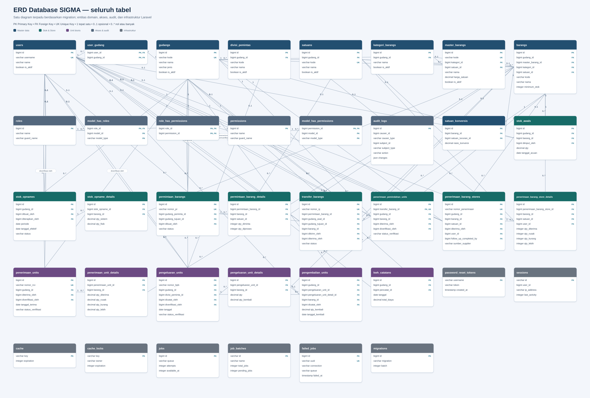

# ERD Database SIGMA

Diagram tunggal ini merangkum skema yang diterapkan oleh migration SIGMA: entitas domain, tabel akses, audit, serta tabel teknis Laravel. Nama entitas menggunakan nama tabel database. Diagram merepresentasikan struktur yang ada, bukan usulan perubahan skema.

## Diagram

Diagram memakai nama tabel database dan menampilkan satu node untuk setiap tabel; warna membedakan master data, transaksi stok/Store, transaksi unit bisnis, akses/audit, dan infrastruktur.

```mermaid
erDiagram
    users {
        bigint id PK
        varchar username UK
        varchar name
        boolean is_aktif
    }
    gudangs {
        bigint id PK
        varchar kode UK
        varchar nama
        varchar jenis
        boolean is_aktif
    }
    user_gudang {
        bigint user_id PK, FK
        bigint gudang_id PK, FK
    }
    divisi_pemintas {
        bigint id PK
        bigint gudang_id FK
        varchar kode
        varchar nama
        boolean is_aktif
    }
    satuans {
        bigint id PK
        bigint gudang_id FK
        varchar kode UK
        varchar nama
        boolean is_aktif
    }
    kategori_barangs {
        bigint id PK
        bigint gudang_id FK
        varchar nama
        boolean is_aktif
    }
    master_barangs {
        bigint id PK
        varchar kode UK
        bigint kategori_id FK
        bigint satuan_id FK
        varchar nama
        decimal harga_satuan
        boolean is_aktif
    }
    barangs {
        bigint id PK
        bigint gudang_id FK
        bigint master_barang_id FK
        bigint kategori_id FK
        bigint satuan_id FK
        varchar kode
        varchar nama
        integer minimum_stok
    }
    satuan_konversis {
        bigint id PK
        bigint barang_id FK
        bigint satuan_turunan_id FK
        decimal rasio_konversi
    }
    stok_awals {
        bigint id PK
        bigint gudang_id FK
        bigint barang_id FK
        bigint diinput_oleh FK
        decimal qty
        date tanggal_acuan
    }
    stok_opnames {
        bigint id PK
        bigint gudang_id FK
        bigint dibuat_oleh FK
        bigint diterapkan_oleh FK
        date periode
        date tanggal_efektif
        varchar status
    }
    stok_opname_details {
        bigint id PK
        bigint stok_opname_id FK
        bigint barang_id FK
        decimal qty_sistem
        decimal qty_fisik
    }
    permintaan_barangs {
        bigint id PK
        varchar nomor_pr UK
        bigint gudang_peminta_id FK
        bigint gudang_tujuan_id FK
        bigint dibuat_oleh FK
        varchar status
    }
    permintaan_barang_details {
        bigint id PK
        bigint permintaan_barang_id FK
        bigint barang_id FK
        bigint satuan_id FK
        integer qty_diminta
        integer qty_diproses
    }
    transfer_barangs {
        bigint id PK
        varchar nomor_sj UK
        bigint permintaan_barang_id FK
        bigint gudang_asal_id FK
        bigint gudang_tujuan_id FK
        bigint barang_id FK
        bigint dikirim_oleh FK
        bigint diterima_oleh FK
        varchar status
    }
    penerimaan_pemindahan_units {
        bigint id PK
        bigint transfer_barang_id FK, UK
        bigint gudang_id FK
        bigint barang_id FK
        bigint diterima_oleh FK
        bigint diverifikasi_oleh FK
        varchar status_verifikasi
    }
    penerimaan_barang_stores {
        bigint id PK
        varchar nomor_penerimaan UK
        bigint gudang_id FK
        bigint barang_id FK
        bigint satuan_id FK
        bigint diterima_oleh FK
        bigint user_id FK
        bigint follow_up_completed_by FK
        varchar sumber_supplier
    }
    penerimaan_barang_store_details {
        bigint id PK
        bigint penerimaan_barang_store_id FK
        bigint barang_id FK
        bigint satuan_id FK
        bigint user_id FK
        integer qty_diterima
        integer qty_rusak
        integer qty_kurang
        integer qty_lebih
    }
    penerimaan_units {
        bigint id PK
        varchar nomor_rcv UK
        bigint gudang_id FK
        bigint diterima_oleh FK
        bigint diverifikasi_oleh FK
        date tanggal_terima
        varchar status_verifikasi
    }
    penerimaan_unit_details {
        bigint id PK
        bigint penerimaan_unit_id FK
        bigint barang_id FK
        decimal qty_diterima
        decimal qty_rusak
        decimal qty_kurang
        decimal qty_lebih
    }
    pengeluaran_units {
        bigint id PK
        varchar nomor_bpb UK
        bigint gudang_id FK
        bigint divisi_peminta_id FK
        bigint dicatat_oleh FK
        bigint diverifikasi_oleh FK
        date tanggal
        varchar status_verifikasi
    }
    pengeluaran_unit_details {
        bigint id PK
        bigint pengeluaran_unit_id FK
        bigint barang_id FK
        decimal qty
        decimal qty_kembali
    }
    pengembalian_units {
        bigint id PK
        bigint gudang_id FK
        bigint pengeluaran_unit_id FK
        bigint pengeluaran_unit_detail_id FK
        bigint barang_id FK
        bigint dicatat_oleh FK
        decimal qty_kembali
        date tanggal_kembali
    }
    kwh_catatans {
        bigint id PK
        bigint gudang_id FK
        bigint pencatat_id FK
        date tanggal
        decimal total_biaya
    }
    roles {
        bigint id PK
        varchar name
        varchar guard_name
    }
    permissions {
        bigint id PK
        varchar name
        varchar guard_name
    }
    model_has_roles {
        bigint role_id PK, FK
        bigint model_id PK
        varchar model_type PK
    }
    model_has_permissions {
        bigint permission_id PK, FK
        bigint model_id PK
        varchar model_type PK
    }
    role_has_permissions {
        bigint role_id PK, FK
        bigint permission_id PK, FK
    }
    audit_logs {
        bigint id PK
        bigint causer_id
        varchar causer_type
        bigint subject_id
        varchar subject_type
        varchar action
        json changes
    }
    password_reset_tokens {
        varchar username PK
        varchar token
        timestamp created_at
    }
    sessions {
        varchar id PK
        bigint user_id
        varchar ip_address
        integer last_activity
    }
    cache {
        varchar key PK
        integer expiration
    }
    cache_locks {
        varchar key PK
        varchar owner
        integer expiration
    }
    jobs {
        bigint id PK
        varchar queue
        integer attempts
        integer available_at
    }
    job_batches {
        varchar id PK
        varchar name
        integer total_jobs
        integer pending_jobs
    }
    failed_jobs {
        bigint id PK
        varchar uuid UK
        varchar connection
        varchar queue
        timestamp failed_at
    }
    migrations {
        bigint id PK
        varchar migration
        integer batch
    }

    users ||--o{ user_gudang : terdaftar
    gudangs ||--o{ user_gudang : memiliki
    gudangs ||--o{ divisi_pemintas : memiliki
    gudangs o|--o{ satuans : memiliki
    gudangs o|--o{ kategori_barangs : mengelompokkan
    kategori_barangs o|--o{ master_barangs : mengelompokkan
    satuans o|--o{ master_barangs : satuan_default
    gudangs o|--o{ barangs : menyimpan
    master_barangs o|--o{ barangs : menjadi_template
    kategori_barangs o|--o{ barangs : mengelompokkan
    satuans o|--o{ barangs : satuan_default
    barangs ||--o{ satuan_konversis : memiliki_konversi
    satuans ||--o{ satuan_konversis : satuan_turunan
    gudangs o|--o{ stok_awals : saldo_awal
    barangs ||--o{ stok_awals : memiliki_saldo
    users o|--o{ stok_awals : menginput
    gudangs ||--o{ stok_opnames : menjalankan
    users o|--o{ stok_opnames : membuat
    users o|--o{ stok_opnames : menerapkan
    stok_opnames ||--o{ stok_opname_details : memiliki
    barangs ||--o{ stok_opname_details : dihitung
    gudangs ||--o{ permintaan_barangs : gudang_peminta
    gudangs ||--o{ permintaan_barangs : gudang_tujuan
    users o|--o{ permintaan_barangs : membuat
    permintaan_barangs ||--o{ permintaan_barang_details : memiliki
    barangs ||--o{ permintaan_barang_details : diminta
    satuans o|--o{ permintaan_barang_details : satuan
    permintaan_barangs o|--o{ transfer_barangs : dipenuhi
    gudangs ||--o{ transfer_barangs : gudang_asal
    gudangs o|--o{ transfer_barangs : gudang_tujuan
    barangs ||--o{ transfer_barangs : ditransfer
    users o|--o{ transfer_barangs : mengirim
    users o|--o{ transfer_barangs : menerima
    transfer_barangs ||--o| penerimaan_pemindahan_units : dikonfirmasi
    gudangs ||--o{ penerimaan_pemindahan_units : menerima
    barangs ||--o{ penerimaan_pemindahan_units : diterima
    users o|--o{ penerimaan_pemindahan_units : menerima
    users o|--o{ penerimaan_pemindahan_units : memverifikasi
    gudangs ||--o{ penerimaan_barang_stores : menerima
    barangs o|--o{ penerimaan_barang_stores : barang_legacy
    satuans o|--o{ penerimaan_barang_stores : satuan_legacy
    users o|--o{ penerimaan_barang_stores : diterima_oleh
    users o|--o{ penerimaan_barang_stores : user_terkait
    users o|--o{ penerimaan_barang_stores : follow_up
    penerimaan_barang_stores ||--o{ penerimaan_barang_store_details : memiliki
    barangs ||--o{ penerimaan_barang_store_details : diterima
    satuans o|--o{ penerimaan_barang_store_details : satuan
    users o|--o{ penerimaan_barang_store_details : user_terkait
    gudangs ||--o{ penerimaan_units : menerima
    users o|--o{ penerimaan_units : diterima_oleh
    users o|--o{ penerimaan_units : diverifikasi_oleh
    penerimaan_units ||--o{ penerimaan_unit_details : memiliki
    barangs o|--o{ penerimaan_unit_details : barang
    gudangs ||--o{ pengeluaran_units : mengeluarkan
    divisi_pemintas o|--o{ pengeluaran_units : peminta
    users o|--o{ pengeluaran_units : dicatat_oleh
    users o|--o{ pengeluaran_units : diverifikasi_oleh
    pengeluaran_units ||--o{ pengeluaran_unit_details : memiliki
    barangs o|--o{ pengeluaran_unit_details : barang
    gudangs ||--o{ pengembalian_units : menerima_pengembalian
    pengeluaran_units o|--o{ pengembalian_units : terkait_transaksi
    pengeluaran_unit_details o|--o{ pengembalian_units : terkait_detail
    barangs o|--o{ pengembalian_units : barang
    users o|--o{ pengembalian_units : dicatat_oleh
    gudangs ||--o{ kwh_catatans : memiliki_catatan
    users o|--o{ kwh_catatans : mencatat
    roles ||--o{ model_has_roles : diberikan_ke_model
    permissions ||--o{ model_has_permissions : diberikan_ke_model
    roles ||--o{ role_has_permissions : mencakup
    permissions ||--o{ role_has_permissions : diberikan_ke_role
```

## Catatan pemodelan

- `PK`, `FK`, dan `UK` menandai primary key, foreign key, dan unique key. Unique gabungan mengikuti migration: `divisi_pemintas (gudang_id, nama)`, `barangs (gudang_id, kode)` dan `(master_barang_id, gudang_id)`, `stok_awals (gudang_id, barang_id)`, `stok_opnames (gudang_id, periode)`, `stok_opname_details (stok_opname_id, barang_id)`, `kwh_catatans (gudang_id, tanggal)`, serta pasangan nama/guard pada `roles` dan `permissions`.
- Pada notasi crow's foot, sisi `||` berarti tepat satu, `o|` berarti nol atau satu, `o{` berarti nol atau banyak, dan `|{` berarti satu atau banyak. FK nullable ditampilkan sebagai relasi opsional.
- `model_has_roles` dan `model_has_permissions` memakai pasangan polimorfik `model_id`/`model_type`; tidak ada FK database dari pasangan itu ke `users`. `audit_logs.causer_*` dan `subject_*` juga polimorfik dan tidak mempunyai constraint FK.
- `sessions.user_id` hanya kolom nullable berindeks, bukan FK pada migration. `password_reset_tokens.username` juga tidak memiliki FK ke `users`; karena itu keduanya tidak digambar sebagai relasi.
- Header penerimaan Store mempertahankan FK barang/satuan opsional untuk kompatibilitas, sedangkan baris barang berada di `penerimaan_barang_store_details`. Beberapa detail transaksi menyimpan snapshot teks historis selain FK barang.
- Tabel cache, queue, session, password reset, dan migration adalah tabel infrastruktur Laravel. `source_groups` dan `audit_logs.changes` adalah data JSON; vector semantic search adalah kolom opsional, bukan entitas atau relasi tambahan.
