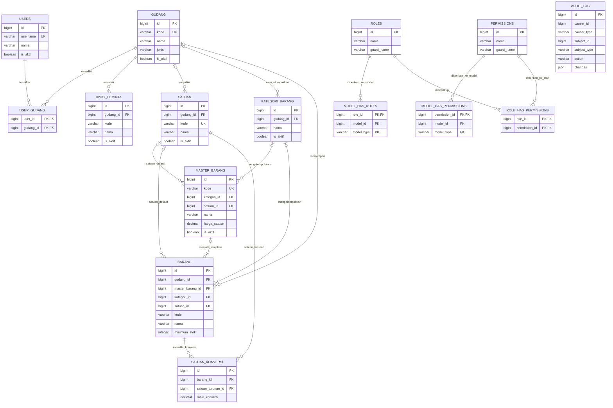
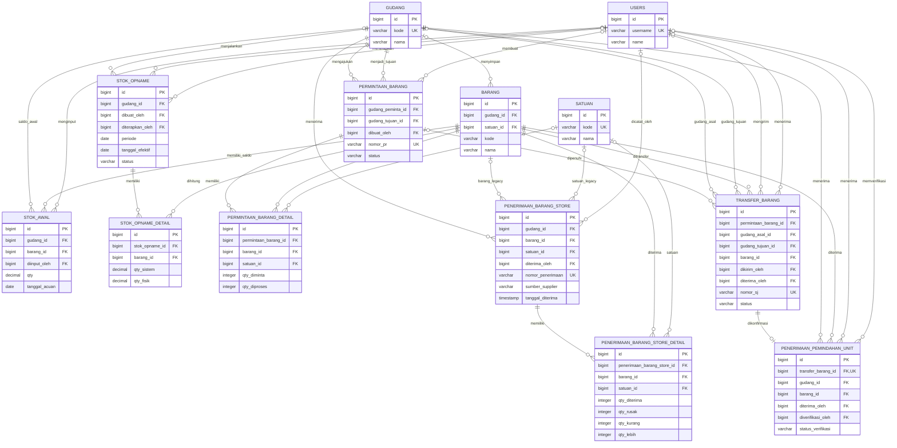
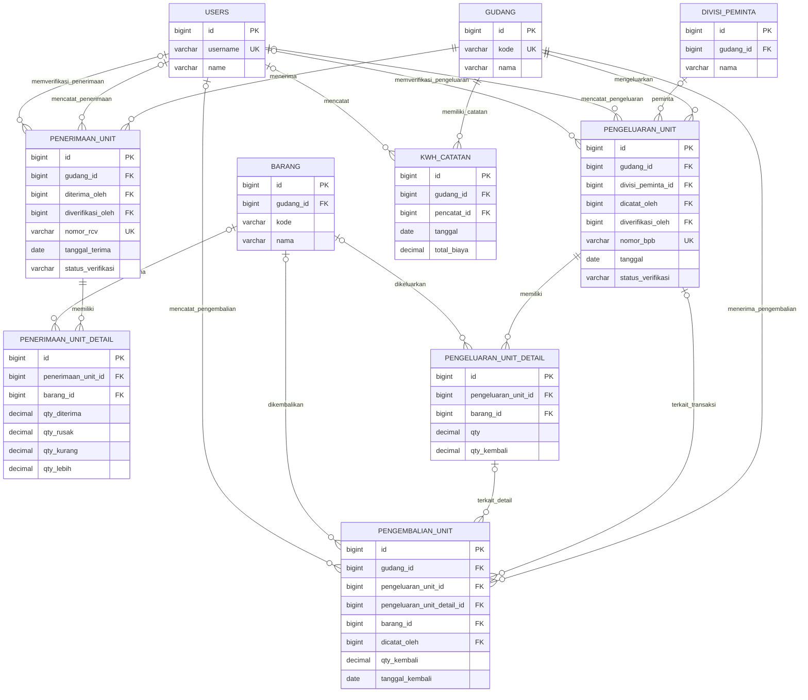

# Entity Relationship Diagram SIGMA

Dokumen ini merangkum skema database SIGMA berdasarkan migration di `database/migrations`. Diagram menampilkan primary key (PK), foreign key (FK), unique key (UK), dan atribut bisnis utama; bukan daftar lengkap seluruh kolom. Relasi mengikuti constraint database, sehingga relasi polimorfik dan kolom yang hanya terhubung di level aplikasi dijelaskan terpisah.

## 1. Identitas, akses, dan master data

Spatie Permission memakai `model_type` dan `model_id` untuk mengaitkan role/permission dengan model apa pun; pasangan ini bukan foreign key biasa ke `users`. `audit_logs.causer_*` dan `subject_*` juga merupakan relasi polimorfik tanpa constraint foreign key.

## 2. Stok, permintaan, transfer, dan penerimaan gudang Store

Saldo awal unik untuk kombinasi gudang dan barang. Stok opname unik untuk gudang dan periode, sedangkan detail opname unik untuk opname dan barang. Header penerimaan Store menyimpan `barang_id` dan `satuan_id` nullable untuk kompatibilitas; rincian penerimaan beberapa barang berada di `penerimaan_barang_store_details`.

## 3. Penerimaan unit, pengeluaran, pengembalian, dan catatan KWh

Detail penerimaan dan pengeluaran menyimpan snapshot teks barang/kategori/satuan selain FK barang opsional. Karena itu, detail historis tetap memiliki nilai snapshot walaupun relasi barang tidak tersedia.

## Catatan skema

- FK nullable digambarkan sebagai relasi opsional pada sisi record anak. Tindakan penghapusan (cascade, restrict, atau set null) tetap mengikuti migration masing-masing.
- Tabel `user_gudang` adalah pivot many-to-many antara pengguna dan gudang. `roles`–`permissions` juga many-to-many melalui `role_has_permissions`; penetapan ke model dilakukan oleh tabel polimorfik `model_has_roles` dan `model_has_permissions`.
- Tabel teknis Laravel seperti `cache`, `cache_locks`, `jobs`, `job_batches`, `failed_jobs`, `sessions`, dan `password_reset_tokens` tidak digambarkan sebagai entitas domain. Tabel-tabel tersebut tidak mengubah alur relasi inventori di atas.
- Fitur semantic search dapat menambahkan kolom embedding pada entitas yang mendukungnya. Kolom vector bukan relasi antar-entitas dan ketersediaannya bergantung pada konfigurasi database/pgvector.
