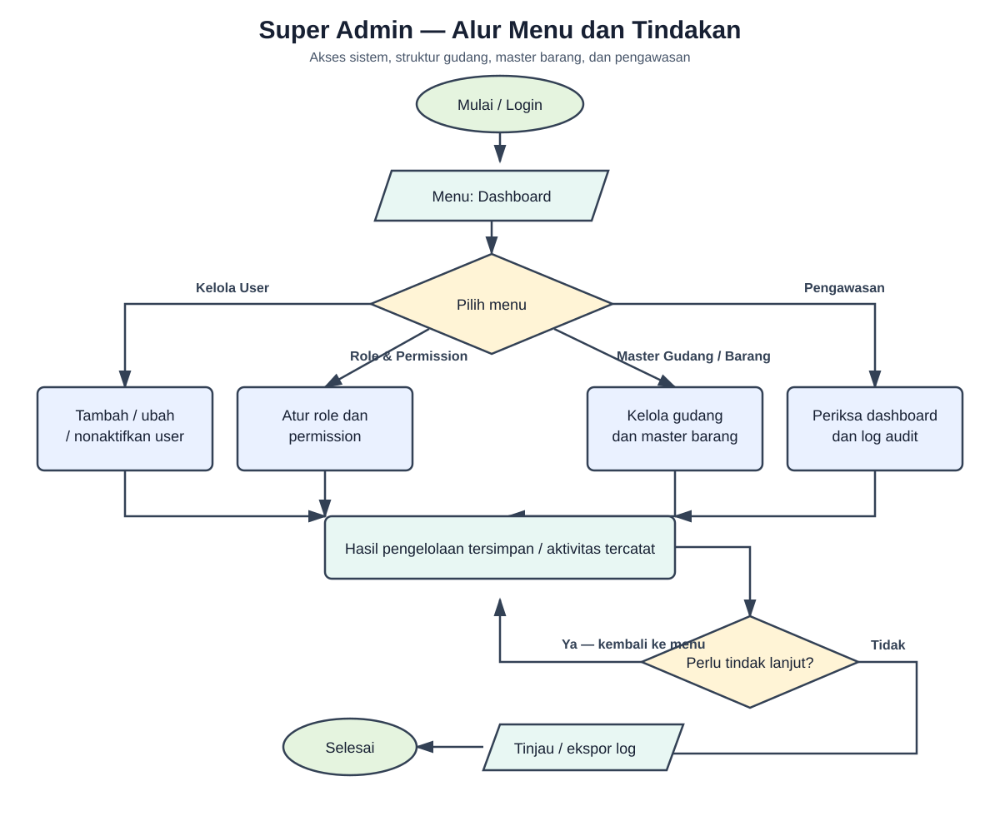
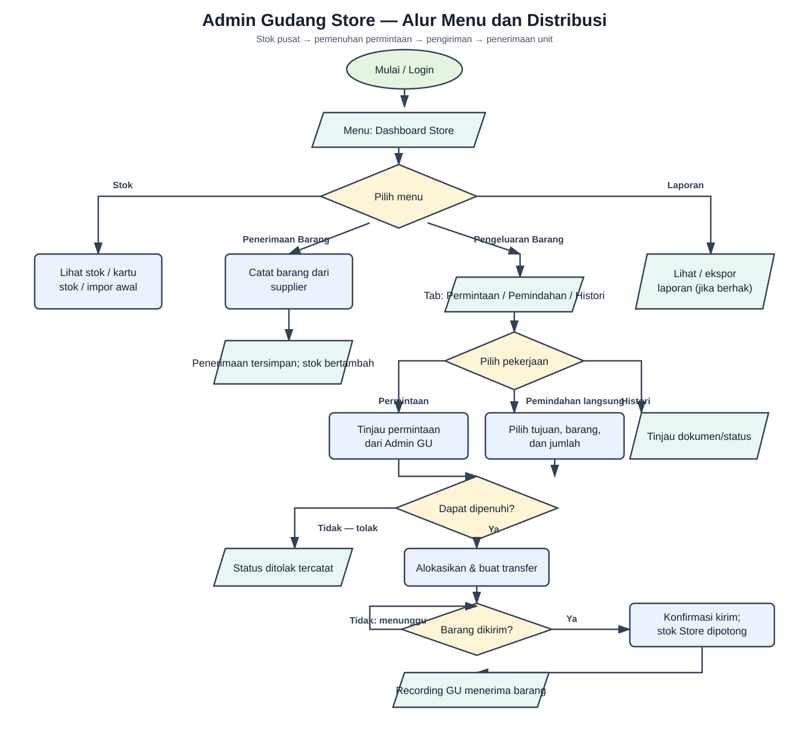
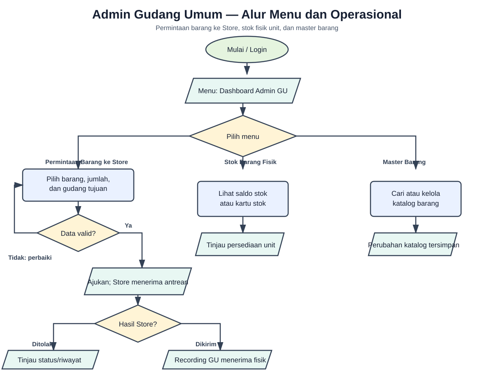
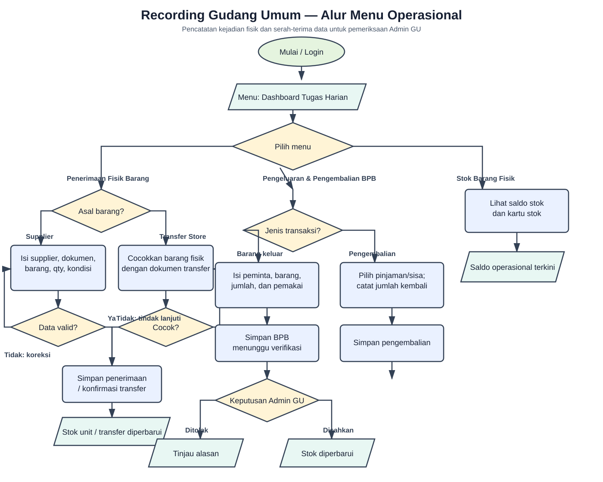
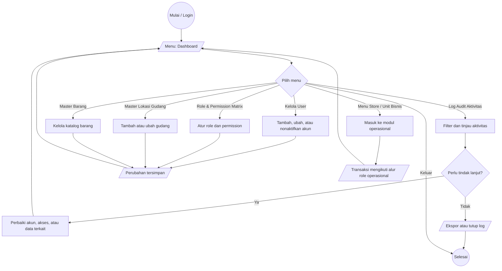
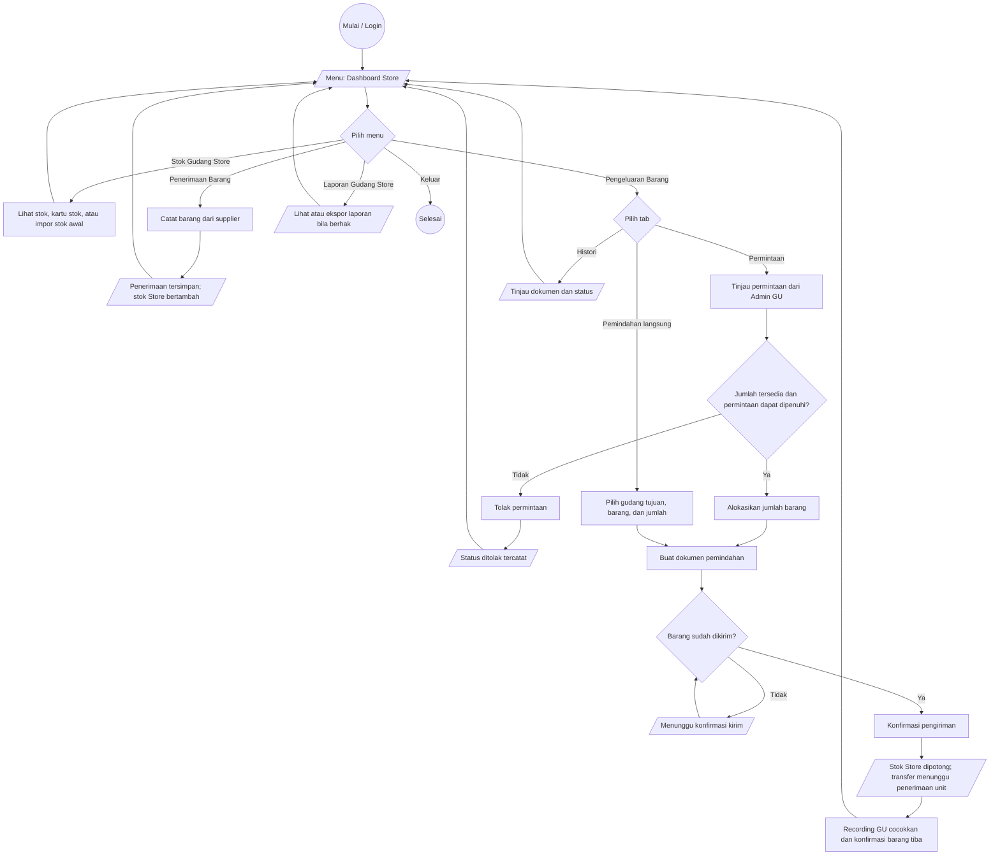
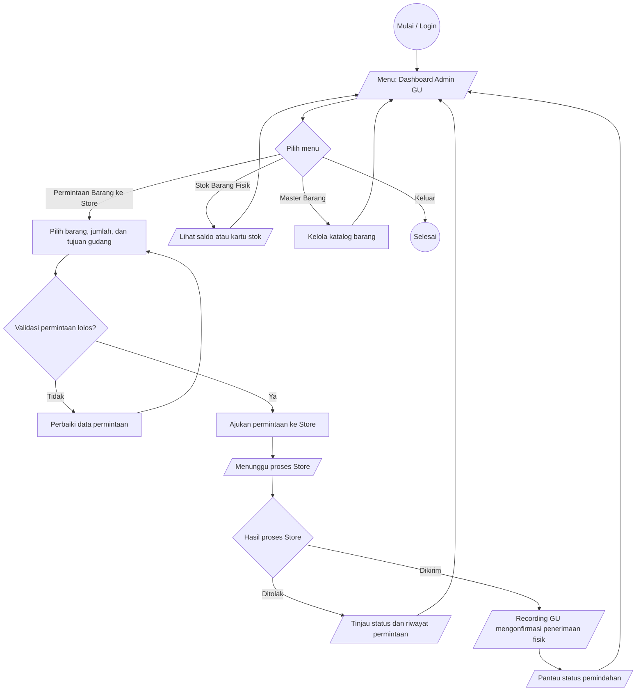
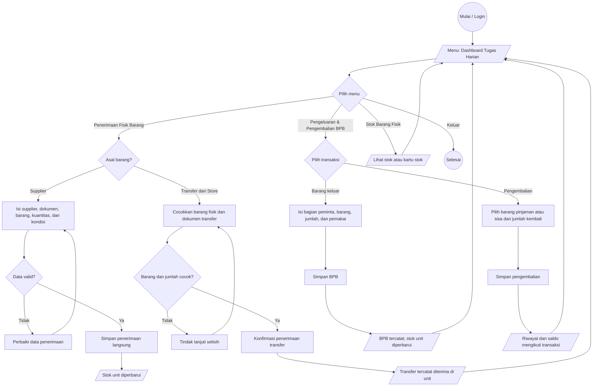

# Flowchart Alur Sistem Berdasarkan Role

Dokumen ini menggambarkan alur yang terlihat pada implementasi saat ini, terutama route di `routes/web.php`, controller, dan seeder role/permission. Empat role yang dibahas adalah **Super Admin**, **Admin Gudang Store**, **Admin Gudang Umum**, dan **Recording Gudang Umum**.

> Diagram menunjukkan fungsi yang tersedia di aplikasi, bukan berarti seluruh proses gudang harus selalu melewati semua role. Beberapa proses dapat berjalan terpisah, dan sejumlah route lama/kompatibilitas masih tersedia.

### Notasi visual

Flowchart memakai simbol standar seperti contoh gambar: **oval** untuk Mulai/Selesai, **jajar genjang** untuk menu atau keluaran/status, **persegi panjang** untuk proses, dan **belah ketupat** untuk keputusan. Label **Ya/Tidak** pada panah menunjukkan cabang keputusan. Visual utama menggunakan gambar SVG agar tetap terlihat pada pratinjau Markdown yang tidak mendukung Mermaid.

## 1. Super Admin

Super Admin mengatur akses dan data dasar organisasi serta memantau aktivitas. Ia memiliki seluruh permission yang didaftarkan oleh seeder; perannya bukan tahapan wajib dalam transaksi gudang sehari-hari.

**Keterkaitan:** mengatur siapa yang dapat menggunakan aplikasi dan gudang mana yang menjadi cakupan pengguna; memantau aktivitas melalui dashboard dan audit log. Super Admin juga dapat menjalankan modul lain karena permission-nya penuh.

## 2. Admin Gudang Store

Admin Gudang Store mengelola persediaan gudang Store dan menangani permintaan barang yang diajukan Admin Gudang Umum. Alur pengiriman baru mengurangi stok Store ketika pengiriman dikonfirmasi.

**Keterkaitan:** permintaan barang dibuat oleh Admin Gudang Umum, kemudian dialokasikan atau ditolak di Store. Setelah dikirim, Recording Gudang Umum di lokasi tujuan mencatat penerimaan fisik transfer. Admin Store juga memiliki penerimaan barang supplier, impor stok awal, kartu stok, dan laporan.

## 3. Admin Gudang Umum

Admin Gudang Umum mengelola kebutuhan stok unit, mengajukan permintaan ke Store, dan memantau persediaan serta kiriman ke unit.

**Keterkaitan:** Admin GU mengirim permintaan barang ke Store dan menerima informasi hasilnya. Admin GU memantau transfer, sedangkan Recording GU mencocokkan dan mencatat penerimaan fisik di unit. Recording GU juga mencatat BPB; perubahan stok unit mengikuti transaksi yang dicatat.

## 4. Recording Gudang Umum

Recording Gudang Umum mencatat kejadian fisik di gudang unit: penerimaan, penerimaan transfer, pengeluaran, dan pengembalian. Catatan transaksi memperbarui pergerakan stok unit.

**Keterkaitan:** menerima transfer yang dikirim Admin Store; membuat catatan penerimaan/pengeluaran yang kemudian dapat diperiksa Admin GU. Route aplikasi juga menyediakan pencatatan barang supplier langsung dan pengembalian. Stok yang ditampilkan mengikuti transaksi dan status yang dikelola service domain.

## 5. Rangkaian lintas-role: permintaan Store sampai diterima unit

1. **Admin Gudang Umum** membuka menu **Permintaan Barang ke Store**, mengisi barang, jumlah, dan tujuan, lalu mengajukan permintaan.
2. **Admin Gudang Store** membuka menu **Pengeluaran Barang** dan meninjau permintaan yang masuk.
3. Jika ditolak, status permintaan menjadi ditolak dan dapat ditinjau Admin GU. Jika diterima, Store mengalokasikan barang dan membuat dokumen pemindahan.
4. Setelah barang benar-benar dikirim, Admin Store mengonfirmasi pengiriman. Pada titik ini stok Store dipotong dan transfer menunggu penerimaan unit.
5. **Recording Gudang Umum** membuka menu **Penerimaan Fisik Barang**, mencocokkan barang fisik dengan transfer, lalu mengonfirmasi penerimaan.
6. Admin GU dapat memantau status pemindahan dan stok unit berdasarkan pencatatan penerimaan.

## 6. Ringkasan hubungan antar-role

| Role | Tanggung jawab utama | Serah-terima ke role lain |
|---|---|---|
| Super Admin | Pengguna, role/permission, gudang, dashboard, audit | Menyiapkan akses dan struktur; memantau aktivitas seluruh modul |
| Admin Gudang Store | Penerimaan dan stok Store, pemenuhan permintaan, pengiriman, laporan | Menerima permintaan dari Admin GU; menyerahkan transfer kepada Recording GU |
| Admin Gudang Umum | Permintaan ke Store, pemantauan transfer, dan stok unit | Mengajukan kebutuhan ke Store; memantau status kiriman |
| Recording Gudang Umum | Pencatatan penerimaan, konfirmasi transfer, pengeluaran, pengembalian | Mencatat kondisi fisik dan transaksi yang menjadi sumber pergerakan stok |

## Catatan pembacaan implementasi

- Alur di atas merujuk pada route/controller yang ada saat ini. Status transaksi dan perubahan stok dijalankan oleh service domain, sehingga detail status akhir dapat mengikuti validasi dan aturan service.
- Tidak semua route dikelompokkan hanya berdasarkan nama role. Sebagian menggunakan permission, sebagian menggunakan middleware role, dan beberapa route kompatibilitas masih ada. Seeder memberikan permission berbeda kepada empat role; akses efektif juga bergantung pada permission yang diberikan pada database.
- “Pemohon” atau “bagian peminta” pada transaksi pengeluaran adalah data operasional yang dicatat Recording GU, bukan role aplikasi kelima yang ditambahkan pada diagram.

## 7. Menu yang diakses setiap role

Nama menu di bawah mengikuti label sidebar di `resources/views/components/sidebar.blade.php`. Item yang tampil tetap bergantung pada permission pengguna dan gudang aktif; nama menu bukan pengganti pemeriksaan akses pada route.

| Role | Menu sidebar utama |
|---|---|
| Super Admin | **Dashboard**; **Kelola User**; **Role & Permission Matrix**; **Master Lokasi Gudang**; **Log Audit Aktivitas**; **Master Barang**; **Stok Gudang Store**; **Penerimaan Barang**; **Pengeluaran Barang**; **Laporan Gudang Store**; **Stok Barang Fisik**; **Permintaan Barang ke Store**; **Penerimaan Fisik Barang**; **Pengeluaran & Pengembalian (BPB)**. |
| Admin Gudang Store | **Dashboard Store**; **Master Barang**; **Stok Gudang Store**; **Penerimaan Barang**; **Pengeluaran Barang**; **Laporan Gudang Store**. |
| Admin Gudang Umum | **Dashboard Admin GU**; **Master Barang**; **Permintaan Barang ke Store**; **Stok Barang Fisik**. |
| Recording Gudang Umum | **Dashboard Tugas Harian**; **Master Barang**; **Stok Barang Fisik**; **Penerimaan Fisik Barang**; **Pengeluaran & Pengembalian (BPB)**. |

**Catatan menu:** seeder saat ini memberikan permission terdaftar kepada Super Admin dan permission domain berbeda kepada tiga role operasional. Sidebar juga mempertimbangkan jenis gudang aktif: misalnya, bagian operasional Unit Bisnis disembunyikan untuk pengguna yang sedang berada pada gudang bertipe Store. Menu yang tampak bisa berbeda jika role/permission di database telah diubah. Admin GU mengajukan kebutuhan melalui **Permintaan Barang ke Store** dan mencatat persediaan pada **Stok Barang Fisik**; penerimaan fisik dan pengeluaran dicatat oleh Recording GU.

## 8. Sumber Mermaid (opsional)

Gambar utama untuk setiap role sudah ditampilkan pada bagian 1–4. Sumber Mermaid berikut disimpan sebagai alternatif yang dapat diedit; buka bagian ini hanya jika ingin melihat atau menyalin kode diagram.

Tampilkan kode sumber diagram Mermaid

### 8.1 Super Admin

### 8.2 Admin Gudang Store

### 8.3 Admin Gudang Umum

### 8.4 Recording Gudang Umum

## 9. Alur lintas-role dan titik serah-terima

1. **Permintaan:** Admin GU mengajukan kebutuhan melalui menu **Permintaan Barang ke Store**.
2. **Pemrosesan:** Admin Store meninjau permintaan melalui **Pengeluaran Barang**, lalu menolak atau mengalokasikan barang.
3. **Pengiriman:** Admin Store membuat pemindahan, mengirim barang, lalu mengonfirmasi kirim. Stok Store berkurang dan transfer menunggu penerimaan.
4. **Penerimaan:** Recording GU mencocokkan barang fisik dan mengonfirmasi melalui **Penerimaan Fisik Barang**.
5. **Pengeluaran unit:** Recording GU mencatat BPB melalui **Pengeluaran & Pengembalian (BPB)**; transaksi tersebut tercermin pada pergerakan stok unit.

### Cara membaca alur dan batas akses

1. Pengguna login, lalu sidebar menampilkan menu berdasarkan role, permission, dan konteks gudang aktif.
2. Memilih menu membuka halaman modul; tindakan simpan/verifikasi tetap melewati validasi dan middleware route. Menu yang terlihat saja tidak menjamin semua aksi di dalamnya diizinkan.
3. Setiap garis serah-terima menunjukkan data/status yang menjadi masukan kerja role berikutnya, bukan persetujuan otomatis.
4. Pada permintaan Store, alokasi belum sama dengan pengiriman: konfirmasi kirim adalah titik pemotongan stok Store. Penerimaan fisik di unit dilakukan Recording GU.
5. Pada pengeluaran unit, Recording GU membuat BPB; pergerakan stok unit mengikuti catatan transaksi, tanpa tahap verifikasi Admin GU.
